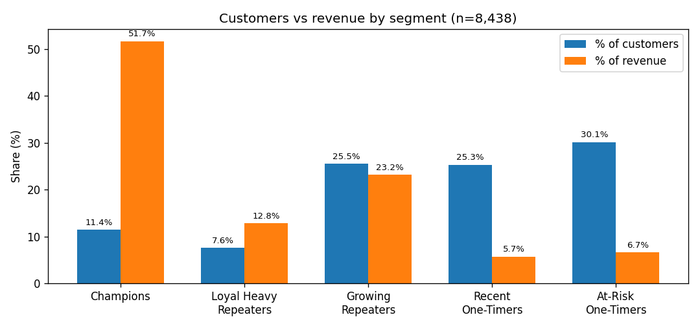

# RFM Customer Segmentation — 11% of Customers Drive 52% of Revenue

E-commerce segmentation (SQL + pandas) on 10,000 customers and 40,000 orders: engineered Recency–Frequency–Monetary features, scored every customer on quintile bins, and collapsed 125 score combinations into five segments with a campaign angle each. Full story in [findings/00_executive_summary.md](findings/00_executive_summary.md).



## What I found

| Segment | Customers | Revenue share | Avg. spend | The move |
|---|---|---:|---:|---|
| Champions | 966 (11%) | 51.7% | Rs 1,51,328 | Early access, insider treatment |
| Loyal Heavy Repeaters | 643 (8%) | 12.8% | Rs 56,248 | Protect cadence, graduate to Champions |
| Growing Repeaters | 2,150 (25%) | 23.2% | Rs 30,471 | Cross-sell, widen the basket |
| Recent One-Timers | 2,135 (25%) | 5.7% | Rs 7,578 | Time-boxed second-purchase trigger |
| At-Risk One-Timers | 2,544 (30%) | 6.7% | Rs 7,397 | One cheap test, then stop |

Two numbers run the whole story: 55% of customers ordered exactly once (just 12% of revenue), and median spend (Rs 12,091) sits far below the mean (Rs 33,522) — the "average customer" describes almost nobody.

## How it was built

- One SQL aggregation per milestone (`sql/`), one row per customer, paid orders only — 2,178 cancelled/failed orders excluded and documented.
- `analysis_date` pinned to the day after the last order (2026-06-15) so Recency is reproducible across milestones, not wall-clock dependent.
- Frequency quintiles collapse when 55% of values are identical, so F uses a documented custom 5-scale instead of forcing `qcut`.
- Every notebook runs top-to-bottom with outputs committed; segment counts sum to 8,438 with no fall-through, and revenue cross-checks across milestones.

## Repo map

- `notebooks/01_exploration.ipynb`, `02_rfm_features.ipynb`, `03_rfm_segments.ipynb` — analysis in execution order.
- `sql/` — the same logic as runnable SQL.
- `findings/` — executive summary plus one writeup per milestone.
- `assets/` — the chart above, generated from live data.

## Reproduce

Credentials come from the environment, never the repo (see `.env.example`):

```
source .venv/bin/activate
pip install -r requirements.txt
export $(cat .env | xargs)   # provides DATABASE_URL
jupyter notebook
```

Run notebooks `01 → 02 → 03`.

## What I'd do next

Price re-acquisition with a holdout win-back test on At-Risk One-Timers before spending on them, fit second-purchase timing for Recent One-Timers from data instead of the 6-week heuristic, and fold returns/refunds into Monetary net of refunds.
